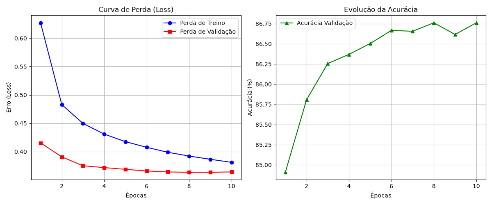
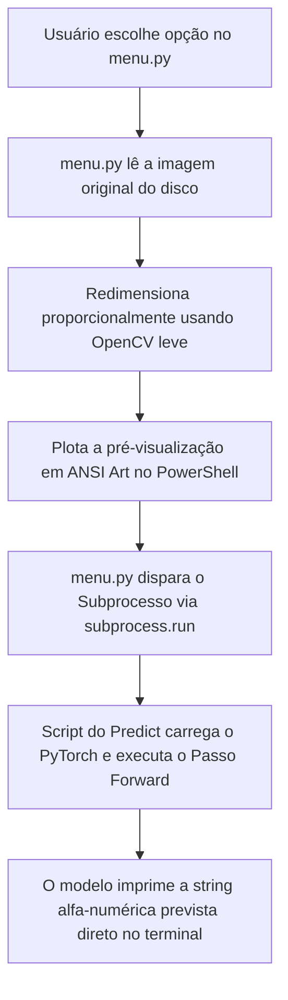
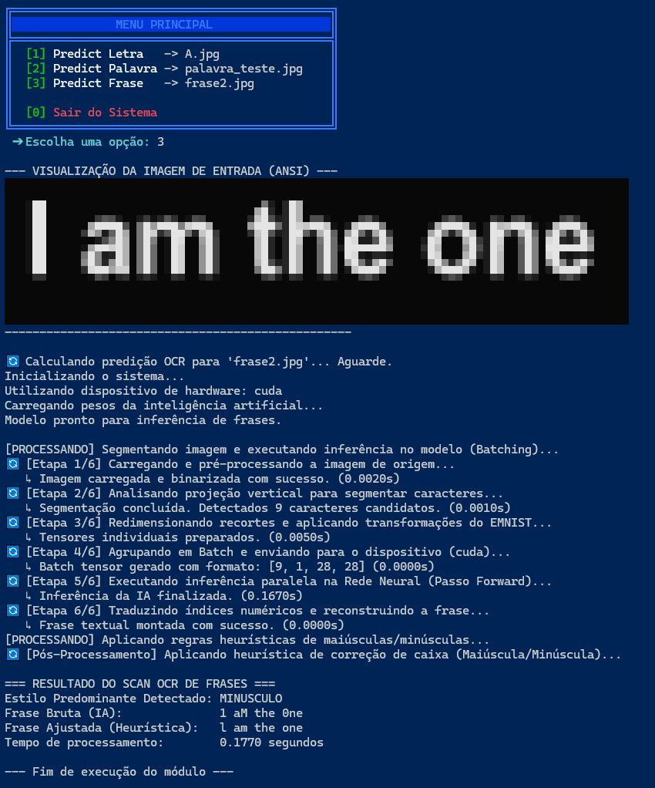

<div align="justify">


# Documentação Técnica: Pipeline de Treinamento, Validação e Checkpointing

Este documento descreve as etapas de engenharia de dados, modelagem convolucional e governança de métricas do script `train_and_evaluate.py`. O objetivo deste script é criar uma inteligência unificada capaz de reconhecer 62 classes de caracteres misturando caligrafia humana e fontes digitais sintéticas do Windows.

---

## 🛠️ Engenharia de Dados Sintéticos Nativos

O script utiliza uma classe personalizada chamada `WindowsFontDataset` que estende a estrutura padrão `torch.utils.data.Dataset`. Essa arquitetura oferece vantagens fundamentais de desempenho:
1. **Geração em Tempo de Execução (On-the-fly):** As imagens de 28x28 pixels não são gravadas fisicamente no HD. Elas são renderizadas diretamente na memória RAM usando a biblioteca Pillow (PIL) a partir das fontes `.ttf` instaladas na pasta do sistema operacional (`C:\Windows\Fonts`).
2. **Correção de Bounding Box Sutil:** O script calcula as coordenadas exatas ocupadas por cada caractere usando o método `draw.textbbox`. Isso neutraliza o espaçamento invisível ("offset") que varia de fonte para fonte, garantindo que letras como "g", "j" ou "p" fiquem milimetricamente centralizadas sem sofrerem cortes nas bordas.
3. **Filtro Automático de Símbolos:** O script utiliza o módulo nativo `glob` para varrer os arquivos do sistema e remove automaticamente fontes exclusivas de símbolos, como *Wingdings* ou *Webdings*, impedindo a injeção de ruídos estocásticos que poderiam desregular os pesos de convergência da rede neural.

---

## 📐 Correção e Alinhamento do Dataset EMNIST

O conjunto de dados EMNIST original carrega uma anomalia herdada do processamento original das matrizes do NIST: as imagens vêm de fábrica rotacionadas em 90 graus e espelhadas (transpostas). 
Como as fontes do Windows são geradas verticalmente de forma correta, o script adiciona uma função anônima lambda (`lambda x: x.transpose(1, 2)`) diretamente no pipeline de transformações do torchvision. Essa correção garante o alinhamento de orientação obrigatório entre os dois datasets antes da operação de fusão executada pelo `ConcatDataset`.

---

## 🧠 Arquitetura da Rede Neural Convolucional (CNN)

A classe `EMNISTCNN` estabelece uma topologia clássica otimizada para o processamento de padrões de caracteres alfanuméricos:
* **Camada Convolucional 1:** Entrada de 1 canal (escala de cinza, 28x28), aplica 32 filtros com kernel 3x3 e padding 1. Reduz o tamanho espacial para 14x14 após o MaxPool 2x2.
* **Camada Convolucional 2:** Recebe os 32 canais e eleva a profundidade para 64 filtros de extração geométrica fina. Reduz a saída para o formato de matrizes 7x7 após a subamostragem por valor máximo.
* **Normalização por Lote (`BatchNorm2d`):** Aplicada em cada bloco após os filtros. Estabiliza o aprendizado distribuindo as ativações de forma Gaussiana, agilizando drasticamente o tempo total de treinamento.
* **Camadas Lineares e Dropout:** Achata o tensor tridimensional para um formato vetorial unidimensional de `64 * 7 * 7 = 3136` posições. Passa por um neurônio Dropout de 30% para mitigar a memorização precoce de pixels irrelevantes (overfitting) e mapeia as ponderações para as 62 classes de destino.

---

## 📊 Governança de Métricas e Gráficos de Aprendizado

Diferente de loops tradicionais, este script adota um mecanismo rígido de **Model Checkpointing** que monitora o comportamento da rede em tempo real:
* **Isolamento de Validação:** O conjunto sintético das fontes do Windows é misturado estritamente na carga de treinamento (`dataset_emnist_train`). A validação do modelo é calculada de forma isolada usando apenas o conjunto oficial de teste do EMNIST (`train=False`). Isso simula um ambiente real de produção.
* **Salvamento Condicional Inteligente:** No final de cada época de treino, a rede entra em modo de congelamento de parâmetros (`model.eval()`). Se a acurácia calculada sobre os dados de teste for estatisticamente superior à maior acurácia registrada nas épocas anteriores, o arquivo `modelo_emnist.pth` é atualizado na pasta de trabalho. Se o desempenho cair ou estagnar, o arquivo em disco é preservado intacto.
* **Renderização de Learning Curves:** O script alimenta um dicionário de histórico (`history`) capturando o comportamento do Erro (Loss) e da Acurácia ao longo das iterações. Ao final de todas as épocas, a biblioteca **matplotlib** plota de forma automática dois subgráficos na tela e os exporta como `curvas_de_aprendizado.png` para inspeção visual do analista.




# Documentação Técnica do Processamento de Imagem: 

# Documentação: Sistema de Menu para OCR (`menu.py`)

O script `menu.py` funciona como a interface de usuário (UI) centralizada e de **inicialização instantânea** para o pipeline de OCR baseado na rede neural convolucional (CNN) treinada com o dataset EMNIST. Ele atua como um orquestrador que desacopla a interação do usuário do carregamento pesado de frameworks de Deep Learning.

---

## 🛠️ Conceitos Arquiteturais Chave

### 1. Latência Zero de Inicialização (Boot Instantâneo)
As interfaces de linha de comando tradicionais para Inteligência Artificial importam bibliotecas pesadas (`torch`, `torchvision`, `numpy`) logo na inicialização, causando um travamento de 3 a 7 segundos antes de exibir o menu na tela.
* O `menu.py` **nunca importa o PyTorch**. Ele permanece extremamente leve, iniciando em **menos de 0.01 segundos**.
* A alocação de memória do PyTorch fica isolada dentro dos scripts trabalhadores independentes (`predict.py`, `predict_word.py`, `predict_frase.py`), sendo carregada dinamicamente apenas quando a opção é escolhida.

### 2. Passagem de Parâmetros via Argumentos de CLI (`sys.argv`)
Para manter os scripts de predição reutilizáveis para diferentes arquivos ou testes, o `menu.py` injeta o nome da imagem como um argumento nativo do sistema operacional na chamada do subprocesso:
```text
[menu.py] ─── subprocess.run ───> [predict_word.py "palavra_teste.jpg"]
```

### 3. Imagens de Alta Densidade no Terminal (Meio-Bloco ANSI)
Em vez de abrir janelas gráficas externas do OpenCV (`cv2.imshow`) — que travam a linha de execução e exigem ambientes com suporte a GUI —, o `menu.py` renderiza matrizes de pixels diretamente no fluxo de texto do PowerShell usando o caractere Unicode de meio-bloco (`▀`).

---

## 🏗️ Pipeline de Execução do Sistema

Quando o usuário escolhe uma opção no painel, o fluxo de execução segue rigorosamente a seguinte ordem:



1. **Pré-renderização Visual:** O menu abre o arquivo de imagem correspondente, reduz sua escala para uma largura confortável, aplica inversão automática de cores caso detecte um fundo claro (garantindo legibilidade no terminal escuro) e a desenha em escala de cinza ANSI de alta fidelidade.
2. **Despacho do Subprocesso:** O nome do script de inferência e a imagem alvo são encapsulados em uma chamada de sistema operacional de forma isolada.
3. **Execução e Liberação:** O script de predição roda de ponta a ponta, processa a inteligência artificial, exibe a classificação final com sua respectiva confiança e encerra limpando a memória RAM imediatamente, retornando o controle para o laço principal do menu.

---




# Documentação Técnica: Pipeline de OCR de Frases (`predict_frase.py`)

O script `predict_frase.py` implementa um pipeline completo de Reconhecimento Óptico de Caracteres (OCR) especializado em **frases escritas à mão ou impressas**. Ele resolve três grandes desafios de visão computacional: a segmentação individual de caracteres colados, a detecção inteligente de espaços entre palavras e a inferência paralela em lote para máxima velocidade.

---

## 🏗️ 1. Arquitetura da Rede Neural Convolucional (CNN)

O modelo utilizado é o `EMNISTCNN`, uma rede convolucional otimizada para classificação de **62 classes** (algarismos de `0-9`, letras maiúsculas de `A-Z` e letras minúsculas de `a-z`).

* **Camadas Convolucionais (`conv1` e `conv2`):** Extraem mapas de características bidimensionais da imagem. Ambas utilizam normalização em lote (`BatchNorm2d`) para acelerar a convergência e funções de ativação `ReLU`. Reduzem o tamanho espacial via subamostragem máxima (`MaxPool2d`).
* **Camadas Totalmente Conectadas (`fc`):** Achatam a matriz de saída (`64 canais x 7x7 pixels`) para um vetor linear e aplicam `Dropout (30%)` para prevenir o sobreajuste (*overfitting*) antes de mapear os dados para as 62 classes finais.

---

## 🏎️ 2. O Pipeline de Processamento (6 Etapas Críticas)

A função `prever_frase` orquestra a inteligência do sistema dividida em etapas estritas de execução cronometrada:

### Etapa 1: Carregamento e Binarização Dinâmica
A imagem fornecida via linha de comando (`sys.argv`) é carregada em escala de cinza pelo OpenCV. 
* **Truque do OCR Crítico:** O algoritmo calcula a média de brilho da imagem. Se o fundo for claro (maior que 127), as cores são invertidas via `bitwise_not`, pois a rede neural exige fundo preto e traço branco.
* **Limiarização de Otsu:** Limpa ruídos de sombras isolando os pixels estritamente em preto (0) ou branco (255).

### Etapa 2: Segmentação por Projeção Vertical e Cálculo de Espaços
A imagem binarizada passa por um histograma de projeção vertical (`np.sum(thresh, axis=0)`). 
1. **Recorte de Caracteres:** Colunas com soma de pixels maior que zero indicam a presença de traços de letras, marcando as coordenadas de corte horizontal (`x_inicio` e `x_fim`).
2. **Algoritmo Estadístico de Espaço:** O script mede a distância (largura) de todos os intervalos vazios entre os caracteres candidatos. Ele calcula a média dessas larguras e define que **qualquer espaço vazio que seja 1.5 vezes maior que a média é considerado um espaço entre palavras**. As posições exatas desses intervalos são salvas para reconstrução posterior.

### Etapa 3: Transformação e Padronização EMNIST
Cada caractere cortado individualmente da frase é normalizado para o formato idêntico ao do treinamento da IA:
* É adicionada uma borda de preenchimento (*padding*) proporcional para a letra não tocar nas bordas da caixa.
* A imagem é redimensionada para exatos **28x28 pixels**.
* É aplicada a normalização matemática de tensores do PyTorch com média `0.1736` e desvio padrão `0.3248`.

### Etapa 4: Agrupamento em Lote (*Batching*)
Em vez de enviar uma letra por vez para a GPU/CPU (o que geraria gargalo de processamento), todos os tensores de caracteres são empilhados em uma única estrutura de dados multidimensional (um *Batch Tensor*) usando `torch.stack`.

### Etapa 5: Inferência Paralela de Alta Performance
O lote inteiro de caracteres é enviado de uma só vez para o hardware disponível (`cuda` ou `cpu`). A rede processa todos os caracteres em paralelo através de uma única passagem adiante (`Passo Forward`) dentro do bloco `torch.no_grad()`, economizando memória computacional. Uma função `softmax` converte as saídas brutas em porcentagens de confiança.

### Etapa 6: Reconstrução de Texto e Injeção de Espaços
Os índices numéricos previstos pela IA são convertidos de volta para letras legíveis através da lista `EMNIST_CLASSES`. Durante o laço de montagem da string, o algoritmo consulta o dicionário de espaços gerado na **Etapa 2** e injeta os caracteres vazios (`" "`) nos locais corretos, gerando a frase bruta final.

---

## 🧠 3. Pós-Processamento: Heurística Baseada em Perfil

Como o dataset EMNIST pode confundir facilmente caracteres semelhantes de caixas diferentes escritos à mão (ex: `o` minúsculo com `O` maiúsculo, ou o número `1` com as letras `l` ou `I`), o script aplica a função `aplicar_heuristica_por_perfil`:

1. **Votação de Caixa:** Ele varre as letras de alta confiança (acima de 75%) que possuem designs unicamente maiúsculos (`A`, `B`, `D`, etc.) ou unicamente minúsculos (`a`, `b`, `d`, etc.).
2. **Definição de Estilo Predominante:** O script define se a frase inteira deveria estar em letras maiúsculas ou minúsculas baseado na maioria dos votos.
3. **Correção de Ambiguidade:** Se o perfil predominante for minúsculo, o algoritmo converte automaticamente erros comuns da IA como o número `0` para a letra `o`, e o número `1` para a letra `l`. Se o perfil for maiúsculo, faz a conversão inversa para garantir a coerência textual do resultado final.
